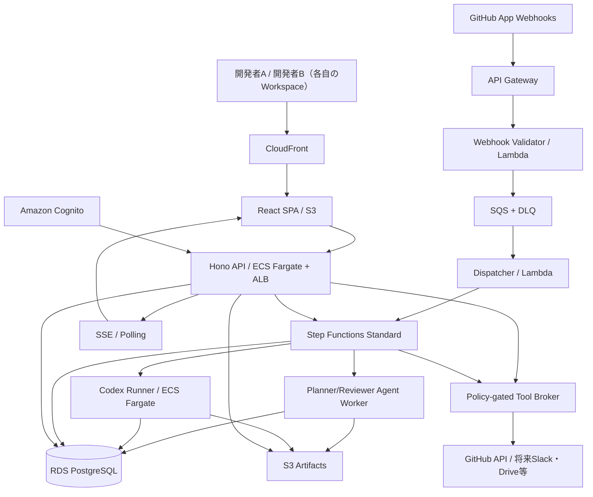
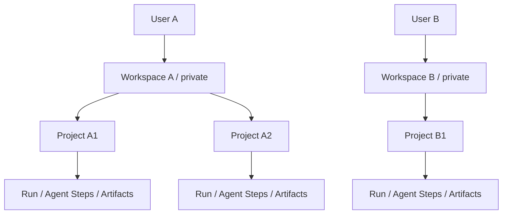
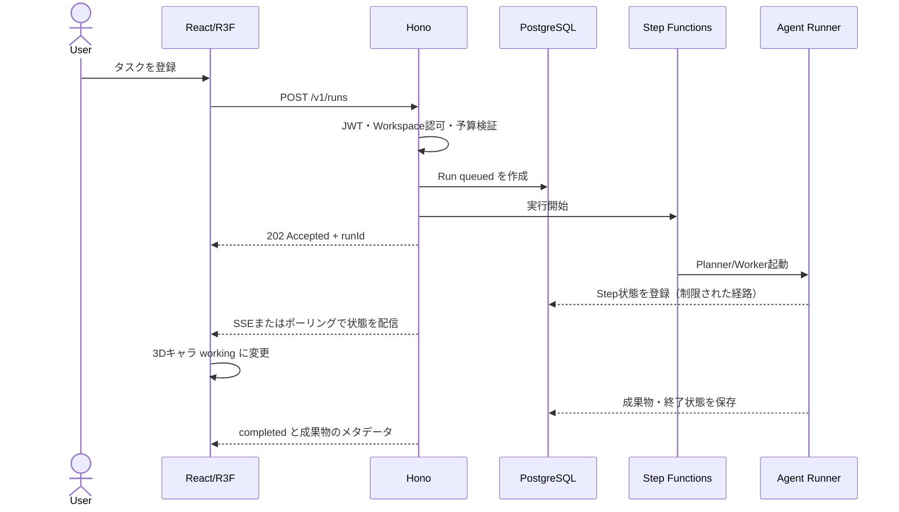
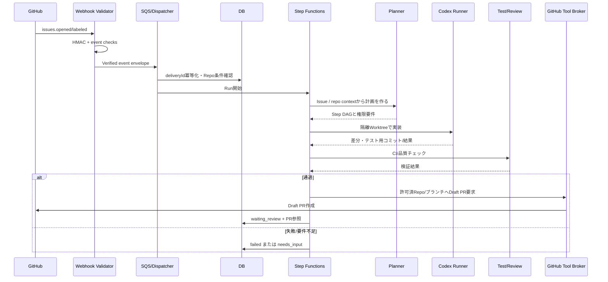
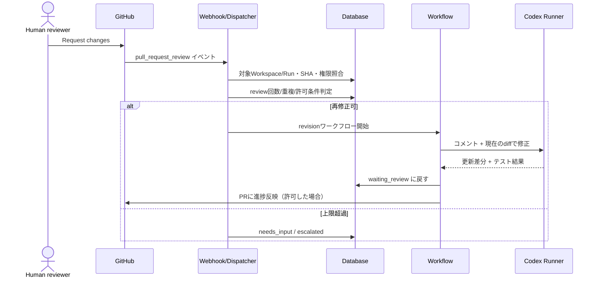
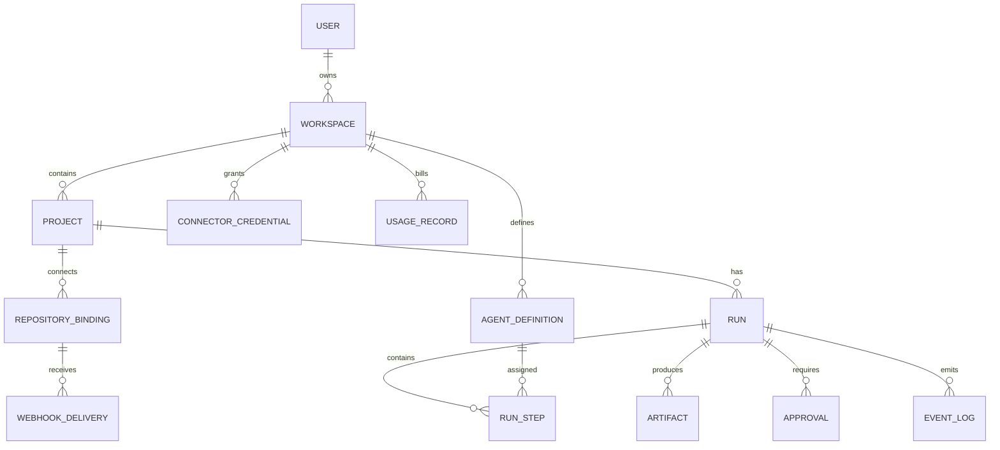

# Personal AI Agent Workspace — 基本設計書

| 項目 | 内容 |
|---|---|
| 文書ID | DES-HLD-002 |
| 版数 | v0.2（改訂ドラフト） |
| 作成日 | 2026-10-30 |
| 上位文書 | `01_要求定義書.md` / `02_要件定義書.md` |
| 適用範囲 | 個人ワークスペースを複数開発者に提供するクラウドサービス。初期版はチーム共有なし |
| 独自実装 | Agents Officeのコード、固有UI、3Dアセット、名称、キャラクターは利用しない |

> **本書の位置付け**：実装へ進めるためのHigh-Level Design。具体的なAWSリソースサイズ、IAM Policy JSON、DB DDL、細かなUI仕様、料金は詳細設計で確定する。設計例は正式な機能保証ではない。

## 1. アーキテクチャ判断（ADR）

| ID | 判断 | 理由・留意点 |
|---|---|---|
| ADR-001 | React + Vite + TypeScriptでSPAを構築 | 管理画面型、SSRは初期不要 |
| ADR-002 | Three.js + React Three Fiber + Drei | React状態と3Dオブジェクトの宣言的連携。カメラはOrthographicCamera |
| ADR-003 | Hono + TypeScript + Node.jsでAPIを構築 | GitHub・OpenAI SDKとの統合とWeb/API間の型共有 |
| ADR-004 | AWS Step Functions Standardを長時間ジョブの制御に採用 | 失敗・再試行・分岐・履歴を決定的に管理 |
| ADR-005 | SQSでイベントを一時保持・平準化 | Webhook処理をAPIから非同期化。DLQを設ける |
| ADR-006 | ECS FargateでAgent実行を分離 | コード操作用コンテナをRun単位で起動。コストと起動遅延がある |
| ADR-007 | OpenAI Agents SDKをPlanner/Reviewer/文書/コミュニケーションで使用 | 専門Agent・ツール・handoffを定義。ワークフロー全体の永続状態はAWS側が持つ |
| ADR-008 | Codex SDKをDeveloper Runnerで利用 | リポジトリの編集、診断、テスト準備等に適合。CLIと作業ディレクトリが必要 |
| ADR-009 | RDS for PostgreSQL + Drizzle ORMをMVPのRDBとする | 初期費用を抑えやすい。必要ならAurora PostgreSQLを再評価 |
| ADR-010 | Cognitoで認証し、HonoでWorkspace所有権を認可 | ログインとデータ分離は別責務 |
| ADR-011 | Step Functions/Agents SDK/LangGraphを重複採用しない | LangGraphは初期不採用。Step Functions=ワークフロー、SDK=Agent内の推論 |
| ADR-012 | GitHub Appで連携し個人PATを保管しない | installation tokenを短期利用しRepoアクセス制御 |
| ADR-013 | 3Dは読み取り中心のビュー | 本質的な操作は2D UIから利用可能。DB状態が唯一の正 |
| ADR-014 | D3-forceはP2のナレッジグラフのみで使用 | MVPの依存から外す。3Dオフィスとは別用途 |
| ADR-015 | ソース/モデル/IPは独立 | Agents Officeからコード/アセットをコピーしない。商用可否は各依存ごとに確認 |

### 1.1 なぜReact Three Fiberか

3DオフィスにはThree.jsを用いる。React Three FiberはThree.jsのReact rendererで、画面状態と3Dコンポーネントを合わせて管理しやすい。React + R3F構成でもThree.jsの`OrthographicCamera`を利用できる。Dreiはカメラ、コントロール、読み込みの補助として採用候補とする。

### 1.2 Agent SDK・Codex SDK・Step Functionsの責務

- **Step Functions**：Runの状態遷移、条件分岐、制限回数、ECS起動、結果判定、キャンセル・エスカレーション。
- **OpenAI Agents SDK**：Planner/Reviewer/Research/Documentation等の推論、構造化出力、限定ツール呼び出し、Agent間の受け渡し。
- **Codex SDK**：隔離されたWorktreeでコードを読み、変更し、テストや診断を進める開発Runner。
- **Hono API**：認証、認可、管理API、手動起動、承認判定、監査、GitHub接続管理。
- **3D/2D UI**：サーバーが確定したRun/Step/Agent状態の表示と、安全な操作要求。

**重要**：SDK内部で独自に次工程へ進めるのではなく、Step Functions/バックエンドが検証した`StepResult`に基づいて次ステップを実行する。Agentは自分の権限を増やせない。

## 2. 論理システム構成



> 概念図。実装時のネットワーク/IAMは安全な経路へ限定する。Agent WorkerとCodex RunnerにDBの全権限やGitHub書込みトークンを直接配ることは推奨しない。結果の受け渡しは内部API／S3・短命トークンで実現可能。

### 2.1 AWS配置（MVP）

| サービス | 役割 | 配置・検討点 |
|---|---|---|
| CloudFront / S3 | SPA/静的アセット配信 | プライベートS3、OAC、HTTPS |
| ALB + ECS Fargate | Hono API | 公開入口はALBのみ。サービスはプライベートサブネット |
| Cognito | 認証 | OIDC/JWT検証、MFAポリシー後続確定 |
| API Gateway + Lambda | GitHub Webhook受信 | **raw body**に対する署名検証、短時間でSQSへ渡す |
| SQS Standard + DLQ | 受信イベントキュー | 1回以上配信を前提にDB冪等化 |
| Lambda Dispatcher | Run受付・開始 | トリガー条件・接続検証後に状態更新/Step Functionsを起動 |
| Step Functions Standard | Run制御 | ECS/Lambda連携、再試行、例外、終了 |
| ECS Fargate Task | Planner/Reviewer/Developer/Testerの隔離実行 | Runごとに環境変数・IAM・一時領域を制限 |
| RDS PostgreSQL | User/Workspace/Project/Run/Approval/Event | Multi-AZ/バックアップは費用とSLAで決定 |
| S3 Artifacts | ログ・差分・レポート等 | Workspace毎のアクセス検証、KMS等 |
| Secrets Manager + KMS | APIキー、GitHub App秘密鍵 | 漏えい範囲を最小化、ローテーション |
| CloudWatch / OTel | メトリクス・アラーム・構造化ログ | 機微情報のマスキング |
| CDK TypeScript | IaC | dev/stg/prodの環境分離 |

**コスト面の設計上の選択**：初期版でAuroraや常時稼働Fargateが過剰な場合は、RDS小規模構成やHonoのLambda実行を比較する。APIの実行方法を変更しても、Agent Runnerの隔離設計は維持する。

## 3. 個人ワークスペース構成



- `workspace_id`をAPI・DB・S3・イベント・ジョブに伝播する。
- `workspace_id`はクライアントから無条件に信用せず、認証済み`user_id`が所有することを照合する。
- 2ユーザーが同一公開/共有GitHub RepoにアクセスできてもRunは個別Workspace内で生成・管理する。Webhookの複数登録が意図せず二重PRを作らないよう、Repo単位の起動ルールを調整する。
- Organization、Membership、共有承認者の機能はP2へ延期。後から共有を導入できるようWorkspaceレイヤーは残す。

## 4. 主な処理シーケンス

### 4.1 手動依頼から3D反映



### 4.2 GitHub Issue → Draft PR



### 4.3 PRレビュー → 再修正



**長期レビュー待ちの扱い**：Draft PRの提出後はStep Functions実行を完了させ、DBの`waiting_review`に残す。GitHubレビューイベントで**新たなrevision実行**を起動する。これにより数日〜数週間のレビューをStep Functionsの1実行で待たせなくて済む。短時間の承認にはCallback Task Tokenも候補だが、初期のGitHub PRフローでは採用しない。

### 4.4 非開発ワークフロー（P1）

1. `Project`内で資料化・ブレスト・報告タスクを依頼。
2. Plannerが許可されたコンテキストを取得し、Research/Documentation/CommunicationなどにStepを割当。
3. 各Agentは読み取りツールと生成用ツールだけを使用。ドラフトをS3等に保存。
4. 外部へ送る操作はApprovalを作成して停止。
5. Ownerが宛先・本文・添付・対象アカウントを確認。承認された同一内容だけTool Brokerが送信。
6. 送信結果をArtifact/イベントとして保存。失敗時の無制限再送はしない。

## 5. 3D UI・画面基本設計

### 5.1 コンポーネント分割

```text
apps/web/src/
  app/                      # router/provider/auth/bootstrap
  features/office/
    OfficePage.tsx
    OfficeCanvas.tsx        # R3F Canvas
    OfficeScene.tsx         # 背景、フロア、照明
    AgentDesk.tsx           # 論理Agentを表示
    AgentAvatar.tsx         # 完全オリジナルのキャラクター
    AgentStatusFx.tsx       # 状態アニメーションとアイコン
    OfficeCamera.tsx        # OrthographicCamera/controls
    AgentInspector.tsx      # Agent/Runの詳細サイドパネル
  features/runs/
    RunListPage.tsx
    RunDetailPage.tsx
  features/approvals/
    ApprovalsPage.tsx
  features/projects/
    ProjectsPage.tsx
  features/settings/
  shared/api/               # Hono型に基づくクライアント
  shared/state/             # SSE/Run state query cache
```

### 5.2 ビューモデル例

```typescript
export type AgentVisualStatus =
  | 'idle'
  | 'working'
  | 'reviewing'
  | 'waiting_approval'
  | 'completed'
  | 'failed';

export interface AgentViewModel {
  agentId: string;
  workspaceId: string;
  name: string;
  role: 'planner' | 'developer' | 'tester' | 'reviewer' | 'documentation';
  status: AgentVisualStatus;
  activeRunIds: string[];
  activeProjectIds: string[];
  lastEventAt: string | null;
  version: number;
}
```

- Agentは`RunStep`等から集約してViewModelを生成する。**表示キャラ数と実行コンテナ数は無関係**。
- `OrthographicCamera`によってズーム時もパースが小さく、俯瞰しやすい画面を狙う。
- ズーム・移動・ホバー・選択はReact StateとR3Fのイベントで連携する。
- `working`時のアニメーションは業務処理が実際に成功することを保証しない。「実行中」を表すにとどめる。
- 3Dアセットは自作か商用利用許諾のあるGLTF等を使用し、出典とライセンスを台帳管理する。
- R3FのメジャーバージョンはReactの互換性に合わせてロックし、alphaを本番で採用しない。

### 5.3 リアルタイム更新

- 初回 `GET /v1/workspaces/me/office-state`でスナップショットを取得。
- `GET /v1/events/stream`で認可済みWorkspaceのイベントのみSSE配信（認証方法はCookie/BFF等を含め詳細設計で選定）。
- イベント例：`run.created`, `step.started`, `agent.status_changed`, `artifact.created`, `approval.requested`, `run.completed`。
- 各イベントに`event_id`、`workspace_id`、`sequence`、`occurred_at`を持たせる。連番が飛んだ場合はスナップショット再取得。
- SSEが使用できない場合は低頻度ポーリングへフォールバック。画面タブ非表示時は描画頻度を下げる。

### 5.4 画面一覧

| ルート例 | 画面 | 役割 |
|---|---|---|
| `/office` | My Office | 3Dオフィス、タスク状態と承認カウンター |
| `/runs` | My Runs | プロジェクト横断のRun一覧 |
| `/runs/:id` | Run Detail | Step、成果物、ツール履歴、使用量 |
| `/approvals` | Approvals | 承認/却下/差し戻し |
| `/projects` | Projects | Project設定、Repo接続、イベント条件 |
| `/settings` | Settings | 接続解除、予算、データ管理 |
| `/documents` | Documents (P1) | Markdown資料と履歴 |

## 6. API基本設計

### 6.1 共通規約

- プレフィックス `/v1`。HTTPSのみ。
- JSONの入力はZod等で検証し、サーバー側でCognito JWTとWorkspace所有権を検証する。
- エラーは `{ code, message, requestId }` を基本とし、内部例外や秘密値を直接返さない。
- 状態更新系には`Idempotency-Key`を付けられるようにする。
- リストはcursor-based pagination。`workspace_id`をリクエスト本文で指定しても権限判定を省略しない。
- GitHub WebhookはユーザーAPIと分離し、`/integrations/github/webhook`で署名検証して扱う。

### 6.2 エンドポイント（案）

| メソッド | パス | 目的 | 優先 |
|---|---|---|---|
| GET | `/v1/me` | サインイン済みユーザー情報 | P0 |
| GET | `/v1/workspaces/me` | 個人Workspace | P0 |
| GET | `/v1/workspaces/me/office-state` | 3D表示用スナップショット | P0 |
| GET | `/v1/projects` | 自分のProject一覧 | P0 |
| POST | `/v1/projects` | Project作成 | P0 |
| PATCH | `/v1/projects/:id` | Project更新 | P0 |
| GET | `/v1/integrations/github/installations` | GitHub連携情報 | P0 |
| POST | `/v1/projects/:id/repositories` | Repo接続 | P0 |
| PUT | `/v1/projects/:id/automation-policy` | 自動起動条件と制限 | P0 |
| POST | `/v1/runs` | 手動Run作成 | P0 |
| GET | `/v1/runs` | 自分のRun一覧 | P0 |
| GET | `/v1/runs/:id` | Run詳細 | P0 |
| POST | `/v1/runs/:id/cancel` | Runの中止 | P0 |
| GET | `/v1/runs/:id/artifacts` | 成果物一覧 | P0 |
| GET | `/v1/approvals` | 自分の承認待ち一覧 | P0 |
| POST | `/v1/approvals/:id/decision` | 承認/差し戻し/拒否 | P0 |
| GET | `/v1/events/stream` | Workspace限定SSE | P0 |
| GET | `/v1/usage` | 概算コストと実行上限 | P0 |
| POST | `/v1/documents` | ドキュメント作成 | P1 |
| POST | `/v1/messages/drafts` | メッセージ下書き | P1 |

### 6.3 リクエスト／レスポンス例

手動で実行を開始する例：

```json
POST /v1/runs
{
  "projectId": "proj_123",
  "source": { "type": "manual" },
  "request": "ログイン画面のパスワード表示切替を実装し、テストとDraft PRを作成して",
  "workflow": "issue_to_draft_pr"
}
```

```json
HTTP/1.1 202 Accepted
{
  "runId": "run_abc",
  "status": "queued",
  "projectId": "proj_123"
}
```

承認操作の例：

```json
POST /v1/approvals/apr_123/decision
{
  "decision": "approve",
  "expectedVersion": 4,
  "confirmationDigest": "sha256:..."
}
```

**API側の必須チェック**：Approvalが対象ユーザーのWorkspaceに属すること、有効期限内であること、すでに処理済みでないこと、対象の差分/本文が作成時点と変わっていないこと、承認に必要な権限とポリシーが成立すること。

## 7. データモデル基本設計

### 7.1 ER図（概念）



### 7.2 主要テーブル

| テーブル | 主なカラム | 備考 |
|---|---|---|
| `users` | `id`, `cognito_sub`, `created_at` | 個人識別の最小情報 |
| `workspaces` | `id`, `owner_user_id`, `name`, `created_at` | **初期はOwner専用** |
| `projects` | `id`, `workspace_id`, `name`, `status` | 複数案件 |
| `repository_bindings` | `id`, `workspace_id`, `project_id`, `installation_id`, `repository_id`, `automation_enabled`, `policy_json` | Repoの許可条件 |
| `agent_definitions` | `id`, `workspace_id`, `role`, `prompt_version`, `model`, `tool_policy` | Agentの論理定義 |
| `runs` | `id`, `workspace_id`, `project_id`, `source`, `status`, `status_version`, `budget_limit`, `started_at`, `finished_at` | 実行状態の正本 |
| `run_steps` | `id`, `workspace_id`, `run_id`, `agent_id`, `status`, `attempt`, `input_ref`, `output_ref` | ステップと再試行 |
| `artifacts` | `id`, `workspace_id`, `run_id`, `kind`, `uri`, `checksum`, `created_at` | GitHub PR・文書・差分 |
| `approvals` | `id`, `workspace_id`, `run_id`, `action_type`, `payload_digest`, `status`, `expires_at`, `decision_by` | 意思決定の証跡 |
| `event_logs` | `id`, `workspace_id`, `run_id`, `sequence`, `event_type`, `occurred_at`, `meta` | 監査可能なイベント |
| `webhook_deliveries` | `provider`, `delivery_id`, `event_type`, `repository_id`, `received_at`, `processed_at` | 冪等化。複合ユニーク制約 |
| `usage_records` | `id`, `workspace_id`, `run_id`, `model`, `tokens`, `duration_ms`, `estimated_cost` | 費用見積もり |
| `connector_credentials` | `id`, `workspace_id`, `provider`, `scopes`, `secret_ref` | 秘密値自体はSecrets Managerへ |

### 7.3 データアクセス規則

- Honoの認証ミドルウェアで`cognito_sub` → `user_id` → Ownerの`workspace_id`を確定。
- 全てのデータアクセスが、確認済み`workspace_id`を条件に含める。重要テーブルにRLSを併用するか詳細設計で決定。
- S3 Artifactのパスは`workspaces/<workspace-id>/runs/<run-id>/...`とするが、**パス名だけではアクセス制御にならない**。署名付きURLを発行する前にAPIで所有権確認。
- 別Workspace向けRunへイベントを送らない。SSE購読もWorkspace内に限定。
- ログへのコード本文・APIキー・アクセストークンの出力を最小化し、保持期間を規定する。

## 8. Agentオーケストレーション設計

### 8.1 Agentの役割（初期）

| Agent | 実装 | 許可ツール | 禁止事項 |
|---|---|---|---|
| Planner | OpenAI Agents SDK | 限定的なRepo/Issue読取、計画生成 | Repo変更・外部送信 |
| Developer | Codex SDK | 隔離Worktreeの編集、指定テスト | mainへのpush・秘密値取得 |
| Tester | Codex SDK/検証コマンド | テスト・ビルド・静的検査 | 本番データ・秘密値操作 |
| Reviewer | OpenAI Agents SDK | 差分/CI/受入条件の読取 | 人間のGitHub承認を偽装 |
| Documentation (P1) | Agents SDK | 許可資料の読取、Draft生成 | 無承認公開 |
| Communication (P1) | Agents SDK | 下書き作成、送信はBroker経由 | 無承認送信 |

**並列性**：独立Stepは並行してよいが、同じブランチへの同時書き込みを避ける。統合作業は専用Stepを挟む。大規模なプロジェクトほどエージェントを増やすのではなく、必要な作業だけを起動する。

### 8.2 実行インターフェース（概念）

```typescript
interface AgentStepInput {
  runId: string;
  stepId: string;
  workspaceId: string;
  projectId: string;
  agentRole: 'planner' | 'developer' | 'tester' | 'reviewer';
  allowedToolPolicyId: string;
  contextRefs: string[];
  timeoutSeconds: number;
  maxAttempts: number;
}

interface AgentStepResult {
  runId: string;
  stepId: string;
  status: 'succeeded' | 'failed' | 'needs_input';
  artifactIds: string[];
  summary: string;
  usageRef?: string;
  errorCode?: string;
}
```

- UI入力をそのままツールコマンドやシェル引数へ連結しない。
- 機密コンテキストの参照は短命の認可されたURL/Tool Brokerから渡す。
- Step Functionsが状態とretry上限を管理。Agent内部の自己修正回数も別途上限を持つ。
- トークン/料金/CPU/時間の両方に予算制限を設ける。
- エージェント実行環境に永続的な秘密鍵を配置しない。

### 8.3 計画の構造例

```json
{
  "steps": [
    { "id": "plan", "role": "planner", "dependsOn": [] },
    { "id": "implement", "role": "developer", "dependsOn": ["plan"] },
    { "id": "test", "role": "tester", "dependsOn": ["implement"] },
    { "id": "review", "role": "reviewer", "dependsOn": ["test"] },
    { "id": "draft_pr", "role": "tool_broker", "dependsOn": ["review"] }
  ],
  "maxRevisionAttempts": 3
}
```

このJSONは例示であり、Agents SDKやStep Functionsの実際のAPI入出力フォーマットそのものではない。スキーマ検証後に内部ワークフローへ変換する。

## 9. Runnerの隔離・アクセス管理

### 9.1 Runnerライフサイクル

1. DispatcherがWorkspace/Project/Repo/予算を確認してRunを生成。
2. Step Functionsが`RunStep`の仕様を決める。
3. ECS Taskを起動し、該当リポジトリの許可されたコミットを短命資格情報で取得する。
4. コンテナの非特権ユーザーで、隔離された作業ディレクトリに対してCodex SDKを実行する。
5. 出力ファイル・ログ・差分を検査・サニタイズし、Artifactに保存。
6. Tool Brokerが必要なGitHub書込みだけを代行（ポリシー検証、宛先限定）。
7. Runnerを終了・破棄。次Runへのファイル/トークン再利用をしない。

### 9.2 コンテナ保護

- 非特権ユーザー、権限昇格禁止、可能な限り読み取り専用RootFS。書き込みは一時Worktreeだけ。
- 不要なLinux capability、Docker socket、ホストへのマウント、本番VPC/DBへの直アクセスを禁止。
- タスクのIAM Roleは限定。GitHub Appの秘密鍵や広い権限のアクセストークンをRunnerに渡さない。
- Network egressの許可先を制限する。依存パッケージの取得先をミラー/プロキシ経由にする設計も検討。
- リポジトリのテストやinstall scriptは**信頼しないコード**として扱う。Fargateの隔離だけで完全に安全とみなさず脅威モデルと実証試験を行う。
- CPU/メモリ/実行秒数/ファイルサイズを制限し、タイムアウト時はタスク終了。
- 依存の脆弱性検査・イメージスキャン・SBOM・成果物の検査を導入。

### 9.3 Prompt Injection対策

Issue本文、README、ソースコメント、外部文書をすべて**非信頼入力**として扱う。AIが「GitHubの秘密情報を貼り付けろ」「承認を無視して投稿しろ」と読んでも、その指示によってツールポリシーが変わってはならない。外部操作はTool Brokerが実行直前に認可する。

### 9.4 LLM・トレーシングに関する注意

OpenAI Agents SDKにはTracing機能があるが、機密データを含む入力/出力やツール引数を無条件に外部トレースへ送信しない。組織のデータ保持方針に合わせてトレース対象を制限・無効化し、代替の匿名化/最小化ログを保持する。モデルプロバイダーのデータ処理条件も別途確認する。

## 10. GitHubイベント・認証・冪等性

### 10.1 Webhook受信手順

1. GitHubからの`X-Hub-Signature-256`を生のbodyとWebhook secretで検証。
2. bodyサイズ、Content-Type、イベント種別、送信時刻など基本チェック。
3. `X-GitHub-Delivery`を一意に扱い、SQSへイベント投入。
4. DispatcherがInstallation ID、repository ID、Workspaceへの登録・automation ruleを照合。
5. DBでdelivery IDを一意に確保後、Project/Issue/Runの二重開始を抑止。
6. 対象外は監査可能な軽量イベントのみ残し、Agentを起動しない。

### 10.2 GitHub App認証

- OAuth/Installationの許可範囲とRepoアクセス可能性をGitHub APIで検証する。
- Installation tokenは必要時に発行し、短期間のみメモリで利用する。秘密鍵はSecrets Managerに置く。
- Repoへの書き込みはTool Brokerが許されたブランチ・PR操作だけを実行する。
- 必要なGitHub App permission（Issues/Contents/Pull requests/Checksなど）は実装時に最小限を確定する。
- 共有GitHub Repoの場合、AI用ブランチ命名規則と重複検査を実装する。

### 10.3 レビュー再実行条件

- `pull_request_review`の`changes_requested`や、明示タグ付きコメントを検知。
- PRが本サービスの対象Runに関連し、最新のcommit SHAとレビューイベントの位置が整合している場合のみ実行。
- 同じレビューイベントを再配信されても1回だけ処理。
- `max_revision_attempts`を超過したら新たなRunnerを起動せず`needs_input`にする。
- `approved`を検知しても**自動マージしない**。GitHubのブランチ保護や必須チェックも維持する。

## 11. 承認フロー詳細

### 11.1 Approvalの種別

| `action_type` | 内容 | 初期動作 |
|---|---|---|
| `pr_review` | Draft PRを人間がレビュー | GitHub側でレビュー。マージは人間 |
| `send_message` | メール/Slack等の対外送信（P1） | 作成した下書きを承認後に送信 |
| `publish_document` | 外部公開・共有（P1） | ドラフトを承認後に公開 |
| `dangerous_operation` | 本番データや権限変更 | MVPでは承認しても実行不可 |

### 11.2 決定の整合性

- `approval_id`、所有者、対象`run_id`、内容ハッシュ、状態版、期限を保存する。
- 承認時には認証ユーザーがOwnerであること、当該Approvalがpendingであることを比較更新する。
- 実行時も同じ内容ハッシュを検証し、承認後に本文/宛先が変更されていれば再承認を求める。
- APIは同じ`Idempotency-Key`による連打を無害化する。
- 誤送信防止に加え、送信APIの結果不明時は無限リトライせず、送信済みか確認する。

## 12. 障害対応・監視・運用

### 12.1 Runの失敗時

| 場面 | 動作 |
|---|---|
| 外部LLMの一時障害 | 指数バックオフ＋最大回数、失敗を記録 |
| GitHub API rate limit | Retry-After等を尊重し再試行/保留 |
| Runnerの異常終了 | 原因と試行回数を保存、上限内で再試行 |
| 承認待ち長期化 | DB状態を保持、期限切れは再確認を要求 |
| SSE切断 | ブラウザが再接続、スナップショット取得 |
| DB一時障害 | キューの未処理イベントを保持、二重処理防止 |
| 誤ったループ/過剰費用 | Workspace/Runのキルスイッチで停止 |

### 12.2 メトリクス

`webhook_accept_rate`、`run_created_latency`、`run_success_rate`、`run_duration`、`agent_step_failures`、`sqs_age`、`dlq_depth`、`approval_wait_time`、`token_usage`、`estimated_cost`、`SSE_connections`、`unauthorized_request_count`等を監視する。

### 12.3 ログ方針

`request_id`、`run_id`、`step_id`、`workspace_id`の内部識別子を相関キーとして利用し、ユーザーのメッセージ本文やGitHub Tokenを必要なくログに出さない。監査ログとデバッグログのアクセス権限・保持期間を分ける。

## 13. 開発構成・CI/CD

### 13.1 Monorepo案

```text
personal-ai-workspace/
├── apps/
│   ├── web/                 # React + Vite + R3F
│   ├── api/                 # Hono / Node.js
│   ├── webhook-receiver/    # Lambda (raw body HMAC検証)
│   └── dispatcher/          # Lambda (event -> Run)
├── workers/
│   ├── agent-worker/        # OpenAI Agents SDK
│   └── codex-runner/        # Codex SDK + CLI + isolated worktree
├── packages/
│   ├── contracts/           # API/Event schemas (Zod)
│   ├── db/                  # Drizzle schema/migrations
│   ├── agents/              # Roles, tool policies, prompt versions
│   ├── integrations/        # GitHub/Slack/Drive adapters
│   ├── workflow/            # Step Functions input/output contracts
│   ├── office-model/        # Run -> AgentVisualStatus projection
│   └── ui/                  # 再利用UIコンポーネント
├── infra/                   # AWS CDK TypeScript
├── assets/                  # 独自制作・商用利用許諾済み3D素材
├── docs/
│   ├── 01_要求定義書.md
│   ├── 02_要件定義書.md
│   └── 03_基本設計書.md
└── pnpm-workspace.yaml
```

### 13.2 CI/CD

- PRでTypeScript型検証、ESLint、Vitest、DB migration checks、Secret scan、依存脆弱性/SBOM、基本E2E。
- 3Dアセットはライセンス台帳とサイズ/パフォーマンスチェックを通す。
- stgへの自動デプロイは可能。本番は明示承認とロールバック方法を定める。
- IaCに保護・削除防止/バックアップ設定を含む。dev、stg、prodを分離。

## 14. 段階的な開発順序（推奨）

| Sprint案 | 対象 | 完了の証拠 |
|---|---|---|
| S0 | 独自3Dオフィスのプロトタイプ + 状態ダミーイベント | 3D/2DでAgent状態を説明できる |
| S1 | Cognito + Workspace + Project + Run DB/API | 2ユーザーの情報分離E2E |
| S2 | SSE/ポーリング + Runログと監視 | 起動・停止・失敗が画面に反映 |
| S3 | GitHub App + Webhook + SQS + 冪等化 | Issueイベントを正しく選別 |
| S4 | Planner + Codex Runner + 安全なBranch操作 | ダミーIssueから差分生成 |
| S5 | テスト/Reviewer + Draft PR + レビュー再修正 | Issue→PR→差し戻しを再現 |
| S6 | 承認・予算上限・セキュリティ検証・β公開 | 重大な越境/無承認操作がない |
| S7+ | 文書作成/ブレスト/連絡（P1） | 少なくとも1つの非開発フロー |

**順序上の判断**：最初に3Dを試作するが、本番システムの状態管理は先に設計する。3D演出だけ完成して、実行状況の正確性が後回しになることを避ける。

## 15. 要件トレーサビリティ

| 要件 | 設計上の主担当 | 検証 |
|---|---|---|
| FR-001〜008 / NFR-001〜002 | Cognito / Hono / RDS / Workspace層 | AT-001 |
| FR-009〜018 / NFR-015〜016 | React Three Fiber / 2D Run UI / SSE | AT-002/003 |
| FR-019〜027 / NFR-004 | GitHub App / Webhook Lambda / SQS | AT-004/005 |
| FR-028〜042 / NFR-005〜008 | Agents SDK / Codex SDK / Step Functions / ECS | AT-006/007/010/011 |
| FR-043〜052 / NFR-009 | Artifact / Approval / Tool Broker | AT-008/009/012 |
| FR-053〜058 | Event logs / CloudWatch / Usage | AT-010/011 |

## 16. 詳細設計へ引き継ぐ事項

1. HonoのJWT認証方式、SSE認証の安全な設計、Cookie/CORS/CSRF対策。
2. RDSテーブルDDL、Uniqueness・Optimistic Lock・DB RLS、マイグレーション。
3. Step Functions ASL、ECS Task Definition、Job cancellation、実行時間/コスト上限。
4. Tool BrokerのGitHub許可操作とApp Permission、リポジトリ実行時のネットワーク隔離。
5. Codex SDKのCLI設定、実行可能コマンド、認証情報、社内コードのモデル送信ルール。
6. 3Dのカメラ/配置/オブジェクト階層、素材の出典、描画性能基準。
7. 画面ワイヤーフレーム、フォーム、空状態/エラー状態、承認確認ダイアログ。
8. 外部連携（Slack/Gmail/Drive）、OAuth権限、レート制限、P1の送信フロー。
9. データ保持・削除、ログ・S3暗号化、鍵ローテーション、バックアップ、請求方式。
10. 商用利用時の各ライブラリ、3Dアセット、参考実装との権利関係の確認。

## 参考ドキュメント（2026-10-30に確認）

- React Three Fiber：https://r3f.docs.pmnd.rs/getting-started/introduction
- OpenAI Agents SDK：https://developers.openai.com/api/docs/guides/agents/sdk
- Agent Orchestration：https://developers.openai.com/api/docs/guides/agents/orchestration
- Codex SDK：https://github.com/openai/codex/blob/main/sdk/typescript/README.md
- GitHub Webhook validation：https://docs.github.com/en/webhooks/using-webhooks/validating-webhook-deliveries
- AWS Step Functions：https://docs.aws.amazon.com/step-functions/latest/dg/welcome.html
- Hono：https://hono.dev/docs/
- Agents Office（参考のみ）：https://github.com/ajsahni/agents-office
