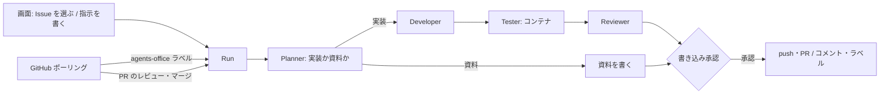

# 自分用 AI 作業場（Issue の実行役）設計

- 日付: 2026-11-02
- 状態: 草案（ユーザー承認待ち）
- 対象: このリポジトリ（agents-office）。関連して meeting-note に 1 か所の変更がある
- `docs/01〜03` は OpenAI と Step Functions を前提にした古い版です。食い違うところは、この設計を正とします

## 1. 目的

agents-office を、t.arai が AI に任せた作業を実行し、案件ごとに進み具合を見る「自分専用の AI 作業場」にする。
入口は 2 つある。普段 Claude Code に頼むような指示を画面から投げることと、GitHub の Issue を選んで任せることである。
PC を閉じていても動き続けるよう、EC2 1 台で常時動かす。

### 夜間 Routine との関係

yulong の夜間 Routine（`nightly-ok` の Issue を毎晩 PR か資料にする）は、そのまま残す。
agents-office は `nightly-ok` の Issue に手を出さない。両方が同じ Issue を処理すると PR が二重にできるためである。

| 担当 | 対象 | 起動 |
|---|---|---|
| 夜間 Routine | `nightly-ok` の Issue | 毎日 1:00、会議後の整備ジョブの候補から Slack ボタンでラベル |
| agents-office | `agents-office` ラベルの Issue と、画面から投げた指示 | 画面で選んだとき、またはラベルを見つけたとき |

## 2. ゴール・非ゴール・失敗とみなすこと

### ゴール

- 案件（Project）ごとに、自分担当か未アサインの open な Issue を一覧し、選んで AI に任せられる
- GitHub 上で自分で `agents-office` ラベルを付けた Issue も、同じように実行される
- AI は Issue ごとに「実装（通常の PR）」か「資料（Issue コメント＋`needs-human`）」を選ぶ
- GitHub に書き込む前に、必ず t.arai が画面で中身を見て承認する
- 実行中・承認待ち・止まった理由を、案件ごとに一つの画面で見られる
- EC2 で常時動かす手順があり、他の人も同じ手順で自分用を立てられる

### 非ゴール

- チームでの共用。一台は一人のもので、その人の claude.ai サブスクで動く
- チームへの進み具合の公開
- meeting-note の画面への組み込み（リンクで飛ぶことも今回は作らない）
- 夜間 Routine の置き換え
- `docs/01〜03` の書き直し

### 失敗とみなすこと

- 承認なしに push・PR・コメント・ラベル変更が GitHub に出る
- AI が触れるコードやテストから、Claude のログイン、GitHub App の鍵、セッション鍵が読める
- 画面や API がインターネットから届く
- 夜間 Routine と同じ Issue を処理して、PR が二重にできる

## 3. 決まっていること（ユーザーの判断）

- 夜間 Routine は残し、agents-office とは対象のラベルで分ける
- Issue の入口は、画面での選択と、GitHub での手動ラベルの 2 つ
- 一覧に出すのは、自分担当か未アサインで、`nightly-ok` と `needs-human` が付いていない open な Issue
- 選んだ Issue には専用ラベルを付け、meeting-note の夜間候補の除外ラベルにも同じ名前を足す
- 置き場所は EC2。PC を閉じても動く
- 一台は一人用。今回は t.arai 専用で作る
- 扱う案件は、t.arai がアサインされている案件のリポジトリ全部
- GitHub App は agents-office 専用に作り、`fenrir-inc` に入れてもらう
- 実行を meeting-note（Fargate）に統合しない。秘密が同居し、CI のデプロイで実行が切れるため

## 4. 全体の流れ

既存の工程（Planner / Developer / Tester / Reviewer、修正ループ、承認、中止、キルスイッチ、予算、同時実行数）は活かす。
変えるのは、入口・GitHub との通信方式・書き込み前の承認・資料モード・Tester の隔離・公開範囲である。

## 5. Issue の入口

### 5.1 画面の Issue 一覧

案件の画面に Issue 一覧を足す。GitHub App の Installation token で、接続した Repo の open な Issue を取る。

一覧の条件は次のとおり。

- PR を除く（`pull_request` キーを持つものを除く）
- 担当が設定のログイン（例 `Toshipy`）か、未アサイン
- `nightly-ok`、`needs-human` が付いていない
- 進行中の Run がある Issue は「実行中」と表示し、選べない

各行に「AI に任せる」ボタンと、任意の追加指示の欄を置く。
押すと、Issue に `agents-office` ラベルを付けてから Run を作る。ポーリングを待たずにすぐ始める。

### 5.2 手動ラベル

GitHub で `agents-office` ラベルを付けた open な Issue も、ポーリングで見つけて Run を作る。
条件は 5.1 と同じで、担当が他人の Issue は見送る（見送った理由は画面に出す）。

ラベルを付けた人が `PAW_GITHUB_LOGIN` 本人のときだけ起動する。Issue の events API で、最新の `labeled`（`agents-office`）の actor を確かめる。
組織のリポジトリでは、他のメンバーがラベルを付けるだけで t.arai のサブスクで Run が動き、Issue 本文からの指示も入るためである。
`PAW_GITHUB_ALLOWED_USERS` は、この 1 人に揃える。

### 5.2.1 着手時のアサイン

Run を始めるとき、未アサインの Issue は `PAW_GITHUB_LOGIN` にアサインする（夜間 Routine と同じ）。
他の人が自分用の agents-office を立てたとき、同じ Issue を複数台が拾わないためである。
アサインした直後に取り直し、他の人も担当に入っていたら、その Run は見送りとして終える。
資料に切り替えたときと、失敗・中止のときは、自分が付けたアサインを外す。もともと担当だった Issue は外さない。

### 5.2.2 資料を書いた Issue の再開

`needs-human` の Issue は、一覧の既定の表示に出さず、「資料済み」の欄にまとめて出す。
そこから選ぶか、GitHub で `agents-office` を付けると、`needs-human` を外して Run を始める。
このとき 6.1 の規則で、資料の後の人のコメントを決定として実装に振り分ける。

### 5.3 画面からの指示

既存のタスク依頼（TaskComposer）はそのまま使う。Issue に紐づかない Run になり、成果は PR だけ（資料モードは無い）。

### 5.4 ラベルの片付け

Run が終わるたびに `agents-office` ラベルを外す。外さないと、ポーリングが同じ Issue で Run を作り直すためである。

| 終わり方 | ラベル |
|---|---|
| PR を作った | `agents-office` を外す |
| 資料を書いた | `agents-office` を外し、`needs-human` を付ける |
| 失敗・中止 | `agents-office` を外す。理由は画面に残し、Issue には書かない |

ラベルの付け外しも GitHub への書き込みだが、Run の開始時に付けるのは t.arai 自身の操作なので承認を挟まない。
終わりの片付けは、6.2 の書き込み承認に含める。失敗・中止での取り外しだけは、承認なしで行う。

## 6. 実行の流れ

### 6.1 実装か資料か

Planner が最初に振り分ける。基準と資料の書き方は、yulong の `.agents/nightly-issue-pr.md`（手順 1.5 と「資料を書く」）を正とする。

- 実装: コードや文書の変更で完了でき、どう直すかを人が決める必要がない
- 資料: 「検討」「確認」「方針を決める」など、人が話して決める内容を含む
- 以前に資料コメント（1 行目が `<!-- nightly-materials -->`）を書いた Issue は、その後に人のコメントがあれば、それを決定として実装に振り分ける。Bot のコメントは人のコメントに数えない
- Developer か Reviewer が「設計の判断が要る」と返したら、変更を捨てて資料に切り替える
- ただし、PR を作った後（レビュー指摘への修正中）と、Issue の無い Run では資料に切り替えず、`needs_input` で止めて理由を画面に出す

資料は、`## 決めること`・`## 現状`・`## 選択肢`・`## 会議で確かめる問い` の順に書き、推奨や結論は書かない。
資料を書く工程は読み取り専用のツールだけで動かす。

夜間 Routine と同じ資料の印（`<!-- nightly-materials -->`）を使う。どちらが書いた資料でも、次にどちらが見ても同じ扱いになるためである。

### 6.2 書き込み前の承認

GitHub に出す前に、必ず画面で承認を取る。承認の種類 `publish` を足す。

- 実装: 差分・テスト結果・レビュー結果・PR のタイトルと本文を見せる。承認すると push して PR を作り、ラベルを片付ける
- 資料: コメント本文と、付け外しするラベルを見せる。承認するとコメントを書き、ラベルを片付ける
- 修正（レビューの指摘への対応）で再び push するときも、毎回承認を取る
- 承認の内容ハッシュには、差分（またはコメント本文）とラベル操作を含める。中身が変わったら古い承認は使えない
- 差し戻すと、理由を添えて Developer（資料なら資料の工程）に戻す

承認待ちの Run は、同時実行数に数えない（既存の `needs_input` と同じ扱い）。

### 6.3 PR

- 通常の PR（Draft ではない）で作る。今の `draft:true` 固定（`github/app.ts:150`）をやめる
- 本文の 1 行目は `Closes #<番号>`。画面からの指示で Issue が無いときは書かない
- ブランチは今どおり `ai/run-<id>`。強制 push はしない
- テストが落ちたままの Run は今どおり失敗にし、PR を作らない

## 7. GitHub との通信

### 7.1 Webhook をやめてポーリングにする

> 2026-11-06 の設計（[aws-alb-access-design](2026-11-06-aws-alb-access-design.md)）で置き換え。

外から入る口を無くすため、Webhook の受け口を本番で無効にする。代わりに、サーバーが GitHub を定期的に見に行く。

- 間隔は 60 秒（設定で変えられる）
- 見るもの: 自動起動が ON の Repo の `agents-office` ラベル付き Issue、PR を持つ進行中 Run の PR の状態とレビュー
- 見つけた変化は、今の `webhook_deliveries` に合成した配信として積み、既存の Dispatcher で処理する。重複は、変化を表す ID（例 `poll:pr:<番号>:review:<review id>`）で弾く

署名付き Webhook の処理とシミュレーターは、開発用として残す。

### 7.2 認証

今どおり GitHub App の Installation token を使う。PR やコメントの作成者は App（bot）になる。
一覧の「自分担当」を判定するログインは、新しい設定 `PAW_GITHUB_LOGIN` で持つ。

App は agents-office 専用にし、meeting-note の App とは分ける（ユーザー判断）。権限が違い、鍵は AI が動く EC2 に置くため、漏れたときの範囲を絞る。

- 権限: Contents・Pull requests・Issues の書き込み、Metadata の読み取り
- 対象: t.arai がアサインされて作業する案件のリポジトリ全部。組織では「選んだリポジトリだけ」でインストールし、案件が増えたら足す
- 案件を足す手順: App のインストール先にリポジトリを足し、画面の Projects で Repo を接続する

## 8. セキュリティ（公開前に直す）

### 8.1 Tester をコンテナで動かす

AI が書き換えたテストやスクリプトを、秘密の見えない場所で動かす。今は API と同じ `paw` ユーザーで動き、`/etc/paw/paw.env` と `github-app.pem` を読める（`runner.ts:247-266`）。

- `docker run --rm` で、worktree だけを書き込み可でマウントする。それ以外のホストのパスはマウントしない
- 環境変数は今の `safeEnv` の範囲だけを渡す
- イメージは Repo の接続設定で指定する（既定は Node.js 22 と pnpm の入ったもの）
- 依存の取得のためインターネットへの通信は許す。秘密がコンテナに無いので、持ち出せるのはそのリポジトリのコードだけになる
- ホストと内部のネットワークには届かないようにする。専用の Docker ネットワークを作り、`DOCKER-USER` で、ホスト、`10.0.0.0/8`・`172.16.0.0/12`・`192.168.0.0/16`・`169.254.0.0/16`、tailnet の `100.64.0.0/10` への通信を落とす
- サーバーモードで Docker が使えないときは、Tester を動かさず Run を失敗にする。ローカル開発では、今の直接実行を設定で選べる

### 8.2 書き込み前の承認

6.2 のとおり。Issue への指示の注入で AI がおかしな変更をしても、承認しなければ外に出ない。

### 8.3 公開範囲

> 2026-11-06 の設計（[aws-alb-access-design](2026-11-06-aws-alb-access-design.md)）で置き換え。

Tailscale Funnel をやめ、Tailscale のネットワーク内だけで開く（`tailscale serve`）。今は `bootstrap.sh:130` でアプリ全体をインターネットに出している。
Webhook も受けないので、インターネットから届く口は無くなる。

### 8.4 `--restricted`

Claude Code 2.1.286 の `--help` で実在を確認した。Bash などコードを動かすツールを外し、ファイル操作を作業ディレクトリに閉じ込め、git や設定ファイルへの書き込みは人か許可ハンドラの承認が要る。

- `deploy/aws/paw.env.example` の `PAW_CLAUDE_CODE_RESTRICTED=0` を 1 にする
- 起動時の検出（`detect.ts`）で `claude --help` に `--restricted` があるかを確かめる
- サーバーモードで `--restricted` が使えない、または 0 に設定されているときは起動を拒む

### 8.5 worktree の `.git` の改ざん

worktree の `.git` はファイルで、git の実体の場所を指している。AI が書き換えると、変更の検査（`changedPaths`）や commit が別の場所を見る（`git.ts`）。

- worktree を作った時点の `.git` ファイルの中身を記録し、AI の工程の後の git 操作の前に照合する。違えば変更を捨てて Run を失敗にする
- AI の工程の後の git 操作は、`--git-dir` と `--work-tree` を明示して、worktree 内の `.git` ファイルを使わない

### 8.6 公開時に危険な既定値を拒む

サーバーモード（`PAW_PUBLIC_URL` がある）では、次のどれかに当たると起動を拒む。

- `PAW_SIGNUP=open`
- `PAW_SEED_DEMO` が有効
- `PAW_DEV_ROUTES` が有効（デモアカウントのパスワードを返す経路を含む）
- `PAW_CLAUDE_CODE_RESTRICTED=0`

## 9. 正しさの修正

| 不具合 | 直し方 |
|---|---|
| Draft PR 作成の再試行で 422 になり Run が失敗する（`repoHost.ts:139`） | 作る前に、同じ head ブランチの open な PR を探す。あればそれを使う |
| `waiting_review` 以外でマージされると無視され、Run が終わらない（`engine.ts:982`） | 終端でない状態ならマージを受け付ける。動いている工程は止めてから完了にする |
| AI のブランチに人がコミットすると止まるか失敗する | 修正の前にリモートのブランチを取り込み、worktree を進める。進められない（衝突など）ときは `needs_input` で止め、理由を画面に出す |
| 作りかけの worktree が残ると二度と進まない（`git.ts:96-107`） | 起点の記録（`.base`）が無い、または壊れた worktree は、消してから作り直す |
| 中止で Claude CLI の終了を待たない | 中止は、Runner の終了（最長 15 秒）を待ってから worktree を片付け、`cancelled` にする |

## 10. 型とテスト

- `apps/api/src/server-mode.test.ts` の 53・66・67 行目の型エラー（TS2571）を直す
- `apps/api/src/claude-code.test.ts:173` が Mac で落ちる（`/var` と `/private/var`）のを、パスを実体に解決して比べるよう直す
- 新しい振る舞いは、既存の `acceptance.test.ts`・`github-app.test.ts`・`claude-code.test.ts` の形でテストを足す
- 完了の条件は `pnpm typecheck` と `pnpm test` が緑であること

## 11. 常時動かす手順

> 2026-11-06 の設計（[aws-alb-access-design](2026-11-06-aws-alb-access-design.md)）で置き換え。

`deploy/aws`（手作業）と `deploy/aws/terraform` を、次に合わせて直す。

- Funnel をやめて `tailscale serve`。`PAW_PUBLIC_URL` は tailnet 内の `https://<名前>.ts.net`
- Docker を入れ、`paw` ユーザーが Tester のコンテナだけを起動できるようにする
- `PAW_CLAUDE_CODE_RESTRICTED=1`、`PAW_SIGNUP=first_user`、`PAW_SEED_DEMO=0`、`PAW_DEV_ROUTES=0`
- 起動後の確認手順（ログイン、Repo 接続、Issue 一覧の表示、1 件の実行）を README に書く

## 12. meeting-note 側の変更

`packages/core/src/teamOps/grooming/nightly.ts` の `NIGHTLY_SKIP_LABELS` に `agents-office` を足す。
agents-office が処理中の Issue を、夜間の候補に出さないためである。meeting-note の PR として別に出す。

## 13. 設計者が決めたこと（ユーザー未確認）

次は会話で決めておらず、設計者が決めた。違えば直す。

| 決めたこと | 理由 |
|---|---|
| ラベル名は `agents-office` | 付けた仕組みが分かる名前にした。PoC の `ai:ready` はやめる |
| GitHub への書き込みは毎回 `publish` 承認を取る | Issue への指示の注入で、おかしな変更が外に出るのを防ぐ |
| 手動ラベルは本人が付けたときだけ起動する | 他人のラベルで自分のサブスクが動くのを防ぐ |
| 着手時に自分をアサインする | 複数台が同じ Issue を拾うのを防ぐ |
| 失敗・中止の理由は Issue に書かない | 画面で見られれば足り、顧客の目に触れるリポジトリに出さない |
| Tester は Docker コンテナで動かす | 別の OS ユーザーより、見える範囲を絞りやすい |
| meeting-note の画面にはリンクも足さない | 一つの画面で見る場所は agents-office にする |

## 14. 作る人に任せること

- ポーリングの実装の細部（取得の並列度、レート制限の扱い、ページング）
- Tester のイメージの中身と、Repo ごとの設定画面の形
- 画面の Issue 一覧の見た目
- 承認画面での差分の見せ方

## 15. 確かめていないこと・制約

- 夜間 Routine は今 DRY_RUN で、yulong の資料の書き方が実運用で固まっているかは未確認
- 実 Issue での確認は、GitHub App を入れた Repo でしかできない
- サブスクで動く Claude Code の費用は 0 として記録されるため、月の予算の上限はサブスクの実行には効かない。利用枠の上限による停止（既存）で止まる
