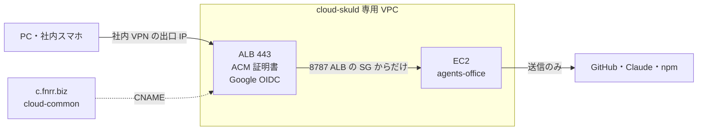

# 社内 VPN と Google ログインで開く常時運用 設計

- 日付: 2026-11-06
- 状態: 草案（ユーザー承認待ち）
- 前の設計: `2026-11-02-issue-runner-design.md`。この文書は、その 7.1（ポーリング）・8.3（公開範囲）・11 章（常時動かす手順）を置き換える。それ以外は前の設計のまま

## 1. 目的

agents-office を EC2 で常時動かし、t.arai が自分の PC と社内用スマホから、社内 VPN 経由で画面を開けるようにする。
PC を閉じている間も Run を進めるのが EC2 を使う理由である。
自社では Tailscale を使わないので、前の設計の「tailnet の中だけで開く」をやめる。

## 2. ゴール・非ゴール・失敗とみなすこと

### ゴール

- `https://agents-office.c.fnrr.biz` を、社内 VPN の出口 IP からだけ開ける
- 開くと会社の Google アカウントでのログインを求められ、t.arai だけが中に入れる
- GitHub のポーリングは平日 9〜19 時（日本時間）だけ、15 分おきに行う
- Terraform で、ALB・証明書・DNS・EC2 をまとめて作れる

### 非ゴール

- 複数人での利用（一台一人のまま）
- ID・パスワードでのログイン（サーバーではやめる。ローカル開発では残す）
- Tailscale の手順の維持

### 失敗とみなすこと

- 社内 VPN の出口 IP 以外から、画面や API に届く
- Google でログインした t.arai 以外の人が、画面や API を使える
- ALB を通らずに EC2 のアプリへ直接届く
- EC2 の権限で、同じアカウントの本番（meeting-note・HEIMDALL・hunters）のリソースに触れる

## 3. 決まっていること（ユーザーの判断）

- 置き場所は AWS アカウント `cloud-skuld`（555379836012）。本番と同居するので、専用の VPC に置き、本番の VPC とはつながない
- 入口は ALB。HTTPS の証明書は ACM、ログインは ALB 標準の OIDC 認証で Google を使う
- ALB のセキュリティグループで、社内 VPN の出口 IP からの 443 番だけを許可する
- ドメインは `agents-office.c.fnrr.biz`。`cloud-common`（308775014250）の公開ゾーン `c.fnrr.biz` に CNAME で登録する
- 使う端末は t.arai の PC と社内用スマホ。どちらも社内 VPN 経由
- ポーリングは平日 9〜19 時だけ 15 分おき。それ以外は止める。始まった Run は止めない

## 4. 構成

### 4.1 ネットワーク

既存の `deploy/aws/terraform` を作り直さずに広げる。この構成で立てた EC2 はまだ無い（状態ファイルも無い）ので、移行は考えなくてよい。

- VPC は agents-office 専用（既定 `10.80.0.0/16`。同じアカウントの既存 VPC `10.20.0.0/16`・`10.10.0.0/16`・`10.128.64.0/20`・`172.31.0.0/16` と重ならない）
- ALB は 2 つの AZ のパブリックサブネットに置く（ALB の要件）
- EC2 はパブリックサブネットに置き、外への通信はインターネットゲートウェイから出す。NAT ゲートウェイは使わない（月の費用を抑えるため）
- EC2 のセキュリティグループは、ALB のセキュリティグループからの 8787 番だけを受ける。それ以外の受信は無い。SSH は開けず、ログインは SSM だけ
- ALB のセキュリティグループは、変数 `allowed_cidrs`（社内 VPN の出口 IP の一覧）からの 443 番だけを受ける。80 番は開けない

### 4.2 証明書と DNS

- ACM の証明書は `cloud-skuld` の ALB と同じリージョンで発行する。検証は DNS 方式
- 検証用の CNAME と、`agents-office.c.fnrr.biz` → ALB の DNS 名の CNAME は、`cloud-common` の `c.fnrr.biz` ゾーンに作る
- Terraform は 2 つのプロバイダー（`cloud-skuld` と `cloud-common`）を使う。`cloud-common` 側は名前付きプロファイル（変数 `dns_profile`、既定 `cloud-common`）で認証する
- `cloud-common` の権限でレコードを作れない場合に備えて、変数 `manage_dns=false` で DNS のレコードを作らない形も選べるようにする。このときは 2 段階で適用する。1 回目で証明書だけを作り、`terraform output` が出す検証用 CNAME を手で登録する。2 回目で証明書の検証完了を待って残りを作る。手順を README に書く

### 4.3 ログイン

- ALB の HTTPS リスナーで、すべての通信に `authenticate-oidc` を掛ける。発行元は Google（`https://accounts.google.com`）
- Google の OAuth クライアントは、会社の Google Cloud で「内部（Internal）」の同意画面で作る。会社のアカウント以外はログインできない
- クライアント ID と秘密は SSM の SecureString に置き、Terraform が読む（Terraform の状態ファイルに秘密が入ることは README に明記する）
- ALB はログインした人の情報を、署名付きの JWT（`x-amzn-oidc-data` ヘッダー）でアプリに渡す

### 4.4 アプリの認証

新しい認証モード `PAW_AUTH=alb_oidc` を足す。サーバーではこのモードだけを使う。

- 毎回の要求で `x-amzn-oidc-data` の署名を確かめる。鍵は ALB の公開鍵（`https://public-keys.auth.elb.<region>.amazonaws.com/<kid>`）。アルゴリズムは ES256
- JWT の `signer` が設定の ALB の ARN（`PAW_ALB_ARN`）と一致し、`exp` が切れておらず、`email` が設定の 1 人（`PAW_ALLOWED_EMAIL`、t.arai@fenrir.co.jp）と一致するときだけ通す。それ以外は 401
- 毎回の要求でこの JWT を確かめ、アプリ独自のセッション Cookie は使わない。ALB はすべての要求（SSE を含む）にヘッダーを付けるので、Cookie を発行し直す必要がない
- `email_verified` が `false` なら拒む。メールの照合は大文字小文字を区別しない。確かめるのは `x-amzn-oidc-data` だけで、アクセストークンは見ない
- 最初に通ったとき、その人のユーザーと個人ワークスペースを作る。`username` はメールアドレス（小文字）、`passwordHash` にはどのパスワードとも一致しない値を入れる。スキーマは変えない
- EC2 の DB は新しく始める（ローカルのデータは移さない）
- このモードでは、新規登録・パスワードでのログイン・デモ用アカウントの経路を無効にする
- 更新系の要求に付ける既存の CSRF 対策（`x-paw-client` ヘッダーと Origin の照合）は残す。`PAW_PUBLIC_URL` の Origin は今も自動で許可に入る
- `/v1/auth/config` は `mode: 'alb_oidc'` を返し、Web はログイン画面を出さずにそのまま中へ進む
- サインアウトは、ALB のログイン Cookie（`AWSELBAuthSessionCookie-*`）を期限切れにして、トップへ戻す。次に開くと Google のログインからやり直しになる
- ALB のログインの有効期限が切れると、API への fetch や SSE は Google へのリダイレクトで失敗する。Web はリダイレクトによる失敗のとき、ページを読み直して ALB のログインをやり直させる（60 秒に 1 回まで）
- アプリが 401 を返したとき（許可していない Google アカウントなど）は、読み直さずに「このアカウントでは使えません」を出す。読み直しを繰り返さないため

### 4.5 起動時の検査（serverGuard）

サーバーモード（`PAW_PUBLIC_URL` あり）では、次のどれかに当たると起動を拒む。前の設計 8.6 の検査に足す。

- `PAW_AUTH` が `alb_oidc` でない
- `PAW_ALB_ARN` か `PAW_ALLOWED_EMAIL` が無い

`PAW_AUTH=alb_oidc` のときは、`PAW_SIGNUP` の検査を不要にする（新規登録の経路そのものが無いため）。

### 4.6 待ち受け

- サーバーモードでは `PAW_API_HOST=0.0.0.0` で待ち受け、ALB からの通信を受ける。届く範囲はセキュリティグループで ALB に絞る
- ALB のヘルスチェックは、既存の `GET /v1/health`（アプリの認証の対象外）を使う。ヘルスチェックは ALB からターゲットへ直接届き、リスナーの OIDC を通らない。利用者からの `/v1/health` は、ほかと同じく OIDC を通る
- ALB のアイドルタイムアウトは 300 秒にする。SSE は既存の ping（`routes/events.ts`）で途切れない
- ALB の OIDC のセッションの有効期限は 7 日（ALB の既定）

## 5. ポーリングの時間帯

- 新しい設定 `PAW_GITHUB_POLL_WINDOW`（既定 `Mon-Fri 09:00-19:00 Asia/Tokyo`）を足す。この時間帯の外では、ポーリングの 1 回分を何もせずに終える
- 時間帯は開始を含み、終了を含まない（9:00 は対象、19:00 は対象外）。起動直後の 1 回も時間帯で判定する。15 分おきの刻みが 9:00 ちょうどに揃わなくてよい
- `PAW_GITHUB_POLL_MS` の既定を 900000（15 分）にする（下限 10000 は前のまま）
- ラベルの検知と、PR のレビュー・マージ・クローズの検知の両方が時間帯の対象になる
- 時間帯の外でも、始まった Run・画面の「AI に任せる」・承認は普段どおり動く
- `PAW_GITHUB_POLL_WINDOW=always` で時間帯の制限を外せる（開発・試験用）

## 6. EC2 の中

- Tailscale の導入・`tailscale serve`・SSM の Tailscale 認証キーをやめる
- `PAW_PUBLIC_URL=https://agents-office.c.fnrr.biz`、`PAW_AUTH=alb_oidc`、`PAW_ALB_ARN`、`PAW_ALLOWED_EMAIL` を `paw.env` に入れる（ARN は Terraform の出力から）
- Tester のコンテナの通信制限（`paw-test-network.sh`）は前のまま。宛先の遮断に含めていた tailnet の範囲（`100.64.0.0/10`）は、害が無いので残す
- IAM ロールは前のまま（SSM の `/agents-office/*` を読む・SSM でのログイン）。ALB・ACM・Route 53 の権限は EC2 に渡さない

## 7. 手順書

- Terraform の手順だけを正にする。手作業の手順（`deploy/aws/README.md`）は、Terraform の README への案内と、EC2 の中の確認手順（通信制限の確認）だけに縮める
- README に、ユーザーの作業を順に書く
  1. 会社の Google Cloud で OAuth クライアントを作る（内部、リダイレクト URI は `https://agents-office.c.fnrr.biz/oauth2/idpresponse`）
  2. クライアント ID・秘密・GitHub App の鍵などを SSM に登録する
  3. 社内 VPN の出口 IP を `allowed_cidrs` に書いて `terraform apply`
  4. 社内 VPN につないだ PC で開き、Google でログインできること、VPN を切ると届かないことを確かめる

## 8. テスト

- `alb_oidc` の検証: 正しい署名・`signer` 違い・期限切れ・別のメール・ヘッダー無し・不正な形式で、通す／401 を確かめる（テストでは鍵を差し替えられる作りにする）
- `alb_oidc` では、新規登録・パスワードでのログインが使えないこと
- serverGuard の新しい拒否条件
- ポーリングの時間帯: 平日の時間内・時間外・土日・境界の時刻・`always`
- `alb_oidc` で `/v1/auth/config` が `alb_oidc` を返し、Web がログイン画面を出さないこと
- `alb_oidc` で初めて通った人のユーザーとワークスペースが作られ、2 回目は同じユーザーになること
- Terraform: `terraform fmt -check` と `terraform validate`。実際の `apply` は人の確認のうえで行う

## 9. 設計者が決めたこと（ユーザー未確認）

| 決めたこと | 理由 |
|---|---|
| EC2 はパブリックサブネットに置き、NAT ゲートウェイを使わない | NAT は月数千円かかる。受信はセキュリティグループで ALB からだけに絞れる |
| 認証は ALB の JWT の署名をアプリで毎回確かめ、独自のセッション Cookie は使わない | ALB の背後でもヘッダーの偽造を防ぐため。ALB が毎回ヘッダーを付けるので Cookie は要らない |
| ヘルスチェックは既存の `/v1/health` を使う | 新しい経路を足さずに済み、ALB のヘルスチェックはリスナーの OIDC を通らない |
| ALB のアイドルタイムアウトは 300 秒、OIDC のセッションは 7 日 | SSE を途切れさせず、毎日ログインし直さなくて済むため |
| `cloud-common` の DNS は名前付きプロファイルで書き、書けないときは 2 段階の手動手順 | 権限があるかが未確認のため |
| EC2 の DB は新しく始める | 前の構成で立てた EC2 が無く、ローカルのデータは確認用だけだったため |
| 許可する人は 1 人のメールアドレスで指定する | 一台一人の前提に合わせる |
| 手作業の手順書は縮める | Tailscale 前提の手順が大半で、二重に保守しないため |
| Terraform の状態ファイルはローカルのまま | 一人用で、今は共有の backend を用意していない。秘密が入るので扱いを README に書く |

## 10. 作る人に任せること

- Terraform のリソース名・サブネットの切り方
- 公開鍵の取得のキャッシュ
- 時間帯の書式の解析の細部

## 11. 確かめていないこと・制約

- 社内 VPN の出口 IP（ユーザーから受け取る）
- `cloud-common` の DeveloperAccess で Route 53 のレコードを作れるか
- 会社の Google Cloud で OAuth クライアントを作る権限があるか
- 社内用スマホのブラウザで ALB の Google ログインが通るか
